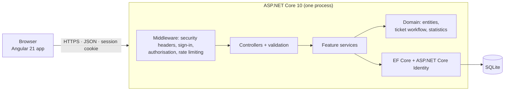

# OpsHub

[](https://github.com/moeletsimelamu/opshub/actions/workflows/ci.yml)

OpsHub is an internal IT service desk. Employees report problems, a support team triages,
assigns and resolves them, and administrators control who has access. It is a full-stack web
application built with **ASP.NET Core 10** and **Angular 21**, set in a fictional logistics
company, Marula Logistics, whose people and tickets are invented demo data.

## The problem it solves

When IT requests arrive by email and chat, they get lost, nobody clearly owns them, and the
person who asked can't see what is happening. OpsHub gives every request:
- one place to live;
- an owner;
- a defined lifecycle with a recorded history.

Requesters can follow their own tickets, and the support team gets a shared queue and live
figures on workload and resolution time.

## Workflows

**Requester** (any employee)
- Reports a problem with a category and a description, and can edit it while it is still open.
- Follows progress, replies to the support team, and answers questions when a ticket is waiting
  for information.
- When a ticket is resolved, confirms the fix (which closes it) or reopens it.
- Sees only their own tickets.

**Support agent**
- Starts on a dashboard: open tickets, tickets waiting for triage, status and priority
  breakdowns, agent workload, resolution time.
- Works the queue through views (needs triage, assigned to me, all active, all), with search,
  filters, sorting and paging kept in the URL.
- Assigns tickets, replies to the requester or adds internal notes the requester never sees,
  and moves tickets through the workflow, including *Send and resolve* in one step.

**Administrator**
- Everything an agent can do, plus adding users, changing roles and deactivating accounts.
- Can't deactivate or demote their own account, so an active administrator always remains.

Every user can change their password. Expired sessions, an unreachable server, editing
conflicts and unsaved changes are all handled in the interface.

## Architecture



A single deployable application (a modular monolith):

| Project | Responsibility |
|---|---|
| `src/OpsHub.Domain` | Entities and business rules: the ticket state machine (`TicketWorkflow`) and resolution-time statistics. No database or web dependencies, so the rules are unit-tested in isolation |
| `src/OpsHub.Api` | REST API organised by feature (auth, users, tickets, dashboard): controllers, DTOs, services, EF Core data access, security and hosting |
| `src/OpsHub.Web` | Angular 21 single-page app: standalone components, signals, zoneless change detection, Angular CDK, its own design system |
| `tests/` | Domain unit tests and API integration tests |

During development the Angular dev server forwards `/api` to the API. In production the API
serves the built Angular app itself. Either way, the browser talks to a single origin, so the
strict session cookie works without CORS.

Full design rationale: [docs/ARCHITECTURE.md](docs/ARCHITECTURE.md).

## Key engineering decisions

**Authentication and authorisation**
- ASP.NET Core Identity with a cookie session: `HttpOnly`, `Secure`, `SameSite=Strict` and a
  `__Host-` prefix. The browser's JavaScript never handles a token.
- An XSRF token is checked on every state-changing request.
- *Secure by default:* every endpoint requires sign-in unless it is explicitly marked public.
- Roles are enforced on the server through policies (`StaffOnly`, `AdminOnly`). Deactivating
  a user or changing a role ends their other sessions within a minute.

**Data visibility**
- Every ticket query starts from one method that limits requesters to their own tickets.
- Another person's ticket returns **404**, not 403, so its existence isn't revealed.
- Internal notes are filtered out in the database query, so they never reach a requester's
  browser.

**Ticket lifecycle**
- Status changes go through a single state machine in the domain layer: Open → In progress →
  Waiting for information → Resolved → Closed, plus reopening.
- The rules decide who may make each change, and when a note or an assignee is required.
- Every change is recorded in the ticket's history.
- The API returns each user's allowed actions with the ticket, so the interface only shows
  controls that will work.

**Concurrency**
- Tickets carry a version token that changes on every save.
- An edit based on an outdated version gets **409 Conflict** instead of silently overwriting
  someone else's change.
- The interface explains that nothing was overwritten and offers the latest version.

**Errors**
- Expected failures are returned as typed results and mapped to RFC 9457 ProblemDetails with
  stable error codes.
- The Angular app tells "you can't do that" apart from "the server is unreachable".

## Technology

| Area | Technology |
|---|---|
| Backend | .NET 10 (SDK 10.0.401), ASP.NET Core Web API, EF Core 10, SQLite, ASP.NET Core Identity, OpenAPI with Scalar |
| Frontend | Angular 21.2, TypeScript 5.9, Angular CDK, self-hosted IBM Plex fonts |
| Testing | xUnit v3 with `WebApplicationFactory`, Vitest with jsdom, axe-core for manual accessibility checks |
| Delivery | Docker (multi-stage build), GitHub Actions |

## Run locally

Prerequisites: [.NET SDK 10.0.401+](https://dotnet.microsoft.com/download),
[Node.js 22.12+](https://nodejs.org/) and a trusted HTTPS development certificate.

### 1. The API

```bash
# 1. Trust the local HTTPS certificate (once per machine)
dotnet dev-certs https --trust

# 2. Restore the pinned dotnet-ef tool
dotnet tool restore

# 3. Choose a password for the fictional demo accounts (stored outside the repo)
dotnet user-secrets set "Seed:DemoPassword" "<at least 12 characters>" --project src/OpsHub.Api

# 4. Run the API (creates src/OpsHub.Api/opshub.db, applies migrations, seeds demo data)
dotnet run --project src/OpsHub.Api --launch-profile https
```

| URL | What |
|---|---|
| https://localhost:7003/health | Health check (`Healthy` when the database is reachable) |
| https://localhost:7003/scalar | Interactive API documentation (Development only) |

### 2. The web app

In a second terminal:

```bash
cd src/OpsHub.Web
npm ci
npm start
```

Open **http://localhost:4200** and sign in with a demo account. To point the dev server at
another API address, set `OPSHUB_API_URL` before `npm start`.

> `npm ci` works with npm 10.9.2. Only creating a lockfile from scratch hits an npm 10.9.2 bug
> (`Cannot read properties of null (reading 'edgesOut')`); use `npx npm@11 install` for that.

### Demo accounts

All use the password from step 3. To reset the demo data, stop the API, delete
`src/OpsHub.Api/opshub.db*` and start it again.

| Email | Role |
|---|---|
| `lerato@marula.example` | Administrator |
| `sipho@marula.example`, `ayesha@marula.example`, `johan@marula.example` | Support agent |
| `kagiso@marula.example` | Support agent (deactivated, so sign-in fails) |
| `thandi@marula.example`, `pieter@marula.example`, `naledi@marula.example`, `ravi@marula.example`, `emma@marula.example`, `busisiwe@marula.example` | Requester |

The script `scripts/Test-SignIn.ps1` walks through the sign-in flow from PowerShell
(XSRF token → sign-in → admin-only call → sign-out):
`powershell -ExecutionPolicy Bypass -File .\scripts\Test-SignIn.ps1 -Email lerato@marula.example`.

## Testing

```bash
# Backend: 58 unit + 135 integration tests
dotnet test

# Frontend: 47 unit and component tests (no browser needed)
cd src/OpsHub.Web
npx ng test --watch=false
```

| Suite | What it covers |
|---|---|
| `tests/OpsHub.Domain.Tests` | The ticket workflow and the resolution-time statistics, with exact values |
| `tests/OpsHub.Api.IntegrationTests` | The real API in memory against a private SQLite database, using a browser-like client (cookies + XSRF header):<br/>· sign-in, lockout and rate limiting<br/>· role and requester-visibility rules<br/>· validation, the workflow and concurrency conflicts<br/>· dashboard figures and security headers<br/>· production hosting: first-run setup, serving the Angular app, reverse proxies, the HTTPS-only API, key storage |
| `src/OpsHub.Web/**/*.spec.ts` | Error interpretation, loading states, workflow buttons, the session interceptor, route guards, and key components |

Critical rules were also **mutation-tested by hand**: each rule was broken on purpose to
confirm that a test fails. This covered requester visibility, internal notes, deactivated
accounts, the fallback sign-in policy, dashboard filters, trusted proxies and the
administrator bootstrap.

### Continuous integration

[`.github/workflows/ci.yml`](.github/workflows/ci.yml) runs on every push to `main` and every
pull request:

- **Backend:** Release build with warnings treated as errors, then all .NET tests.
- **Frontend:** `npm ci`, unit tests, production build with bundle budgets, and `npm audit` of
  production dependencies.
- **Container:**
  1. Build the Docker image.
  2. Start it like a first production deployment, behind an HTTPS reverse proxy.
  3. Run the [smoke test](scripts/smoke-test.sh): health, the page and its security headers, a
     real sign-in.
  4. Restart the container, then run the smoke test again.

## Security

- Passwords hashed with PBKDF2 by ASP.NET Core Identity; a 12-character minimum without forced
  character rules, following NIST SP 800-63B.
- Account lockout after 5 failed attempts, and sign-in rate limiting per client IP address.
  Behind a proxy, forwarded addresses are trusted only from configured proxies.
- Sign-in errors don't reveal whether an email address has an account.
- Content-Security-Policy that only allows scripts from OpsHub itself, plus `nosniff`, no
  framing, no referrer, HSTS outside development and a 1 MB request limit.
- The API refuses plain HTTP, because its cookies are HTTPS-only.

A review of security, accessibility (WCAG 2.2 AA, 0 axe-core violations) and responsive
layout (375–1440 px), with each finding and how it was verified, is in
[docs/REVIEW.md](docs/REVIEW.md).

## Deployment

OpsHub ships as one Docker image. The API serves the built Angular app, HTTPS is handled by a
reverse proxy in front, and the SQLite database and session keys live on a `/data` volume. A
new installation creates its roles, starter categories and first administrator from
configuration; the fictional demo data is refused in Production.

```bash
docker build --tag opshub .
```

The image is built and tested in CI behind an HTTPS reverse proxy, and the production build
was also tested locally over HTTPS. **It hasn't been deployed to a cloud provider.**
Settings, a first deployment, a public demo, upgrades, backups and a go-live checklist are in
[docs/DEPLOYMENT.md](docs/DEPLOYMENT.md).

## Known limitations

- **One instance only.** SQLite and file-based session keys don't support running several
  copies.
- **No email.** No password reset by email, notifications, email verification or MFA.
- **No category management screen.** New installations start with five general IT categories.
- **No assignment history.** Assignment changes aren't recorded in a history table; status
  changes are.
- **Session keys are stored unencrypted** on the data volume, which therefore must be
  protected.
- **Accessibility testing** used axe-core and keyboard checks in Chromium. Screen readers and
  other browsers weren't tested.
- **`npm audit` reports advisories in `undici`.** It's used only by the Angular build tool and
  isn't shipped to browsers. Production dependencies report 0 vulnerabilities.

## Future improvements

- PostgreSQL and shared key storage, so more than one instance can run.
- Email notifications and self-service password reset.
- A category management screen and an assignment history.
- Automated accessibility checks in CI, and screen-reader testing.
- A hosted demo.

## Documentation

| Document | Contents |
|---|---|
| [docs/ARCHITECTURE.md](docs/ARCHITECTURE.md) | Structure, data model, security model, API conventions, business rules and the reasoning behind them |
| [docs/DESIGN.md](docs/DESIGN.md) | Design system (colour, type, spacing, components) and screen designs |
| [docs/REVIEW.md](docs/REVIEW.md) | Security, accessibility and responsive-design review |
| [docs/DEPLOYMENT.md](docs/DEPLOYMENT.md) | Production setup, settings, deployment, backups and go-live checklist |

Database schema changes:
`dotnet ef migrations add <Name> --project src/OpsHub.Api --output-dir Data/Migrations`.
