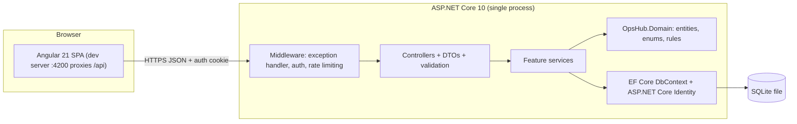
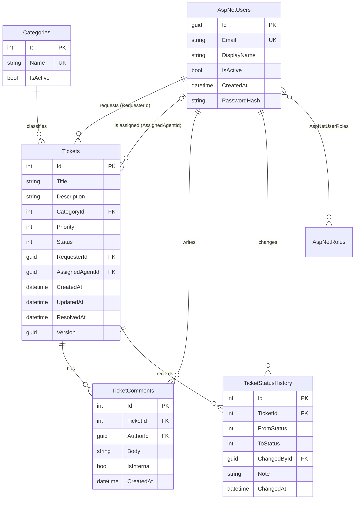
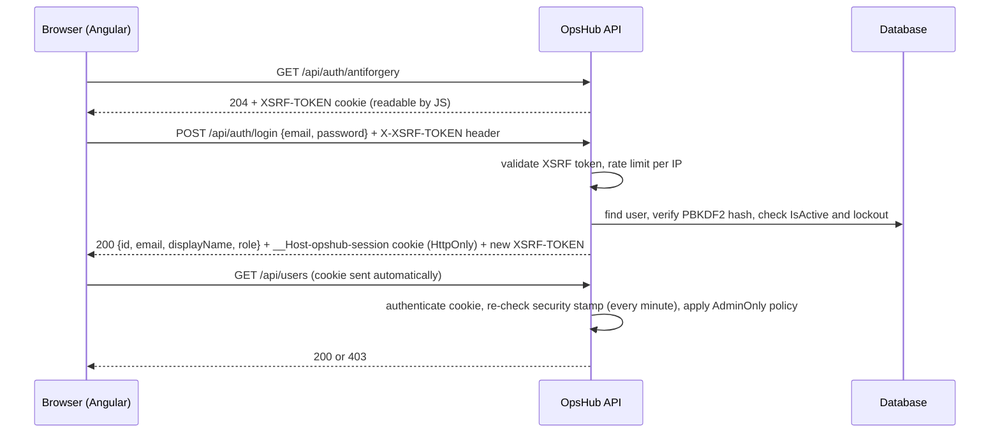

# OpsHub Architecture

This document records the design decisions behind OpsHub and the reasons for them.
It is updated as each phase lands. Sections marked **(planned)** are not built yet.

## 1. Context

OpsHub is an internal service desk for **Marula Logistics**, a fictional company.
Employees (requesters) log support tickets; support agents triage, assign and resolve them;
administrators manage users. All data is fictional.

| Role | Primary tasks |
|---|---|
| Requester | Log a ticket, follow its progress, answer agent questions |
| Support Agent | Work a queue: triage, assign, change status, comment, resolve |
| Administrator | Everything an agent can do, plus manage users and roles |

## 2. System overview



One deployable application (a *monolith*). In production it ships as a single container in
which the API also serves the built Angular app, behind an HTTPS reverse proxy
([DEPLOYMENT.md](DEPLOYMENT.md)). Microservices and message brokers would add operational
cost without solving any problem this application has.

## 3. Technology choices

| Area | Choice | Reason |
|---|---|---|
| Runtime | .NET 10 (LTS, supported to Nov 2028) | Current long-term-support release; pinned in `global.json`. |
| Data access | EF Core 10 with migrations | Schema changes are versioned C# files that are reviewed and committed. |
| Database | SQLite | A single file with no server to install; runs on Windows, macOS and Linux CI. |
| Users and passwords | ASP.NET Core Identity | Salted PBKDF2 hashing, lockout and roles; we never write our own crypto. |
| API docs | Built-in OpenAPI + Scalar UI | `/openapi/v1.json` and `/scalar` in Development. |
| Errors | RFC 9457 ProblemDetails | Every error has the same JSON shape with a `traceId`. |
| Logging | Built-in `ILogger`, source-generated `[LoggerMessage]`, JSON console outside Development | Structured logging without extra packages. |
| Tests | xUnit 4 on Microsoft.Testing.Platform, `WebApplicationFactory`; Vitest + jsdom for Angular | Backend tests boot the real API against an in-memory SQLite database; frontend tests run without a browser. |
| CI | GitHub Actions (`.github/workflows/ci.yml`) | Every push and pull request is restored, built (warnings as errors), tested and audited on a clean Ubuntu runner. |
| Time | `TimeProvider` via dependency injection | Tests can control the clock. |

## 4. Solution structure

```
OpsHub/
├─ src/
│  ├─ OpsHub.Domain/        entities, enums, role names, TicketWorkflow, Reporting statistics
│  │                        (no EF Core / ASP.NET Core)
│  ├─ OpsHub.Web/            Angular 21 app (see § 12)
│  └─ OpsHub.Api/
│     ├─ Auth/              Identity + cookie setup, policies, XSRF filter, ICurrentUser
│     ├─ Common/            Result/Error types, ProblemDetails mapping, paging
│     ├─ Data/              DbContext, entity configurations, migrations, reference/demo data,
│     │                     first-administrator bootstrap
│     ├─ Features/          controller + DTOs + service per feature (Auth, Users, Tickets, Dashboard)
│     ├─ Hosting/           serving the Angular app, reverse-proxy headers, session-key storage
│     ├─ Security/          response security headers, HTTPS-only API
│     └─ Program.cs         composition root: DI registrations and HTTP pipeline
├─ tests/
│  ├─ OpsHub.Domain.Tests/          unit tests for the workflow and statistics (no database)
│  └─ OpsHub.Api.IntegrationTests/  real API + in-memory SQLite, browser-like client
├─ docs/
├─ scripts/                 smoke test for a running instance, sign-in check script
├─ Dockerfile               multi-stage build: Angular app + API in one image
├─ global.json              pins the .NET SDK and selects the test runner
├─ Directory.Build.props    shared compiler settings (nullable, warnings as errors, analyzers)
└─ dotnet-tools.json        pins the dotnet-ef CLI version
```

**Why not a full Clean Architecture (Application / Infrastructure / Web projects)?**
`DbContext` already implements the unit-of-work and repository patterns. Wrapping it in
repository interfaces would add code without adding a capability we use. The business
rules are still kept apart in `OpsHub.Domain` so they can be unit-tested without a database.

**Deviation from the original plan:** `OpsHub.Domain` references
`Microsoft.Extensions.Identity.Stores`, because `AppUser` inherits from `IdentityUser<Guid>`.
That package contains only the Identity base classes; Domain still has no EF Core or ASP.NET Core
dependency.

## 5. Data model



### Constraints and why they exist

| Rule | Where | Why |
|---|---|---|
| Users referenced by tickets cannot be deleted (`ON DELETE RESTRICT`) | Tickets, comments, history FKs | Users are deactivated (`IsActive = false`) so the audit trail keeps its authors. |
| Comments and history are deleted with their ticket (`CASCADE`) | TicketComments, TicketStatusHistory | They have no meaning without the ticket. Tickets themselves are never deleted; *Closed* is the final state. |
| `CK_Tickets_Priority`: 1–4, `CK_Tickets_Status`: 1–5 | Tickets | The database rejects invalid enum values even if the API has a bug. |
| `CK_Tickets_ResolvedAt` | Tickets | Active tickets have no resolution time; *Resolved* tickets must have one; *Closed* may or may not (a ticket can be closed without being resolved). |
| Unique `NormalizedEmail` and `Categories.Name` | Indexes | Email is the sign-in name; category names appear in filters. |
| `Version` concurrency token | Tickets | Rotated on every save. A stale edit throws `DbUpdateConcurrencyException`, which the API returns as **409 Conflict**. |
| Enums stored as integers | Priority, Status | Sorting by priority gives Low → Critical; as text, "Critical" would sort first. |
| Timestamps are UTC `DateTime` | All tables | EF Core's SQLite provider cannot order or compare `DateTimeOffset`. A value converter marks values read back as UTC. |

Indexes on `Status`, `Priority`, `CategoryId`, `RequesterId`, `AssignedAgentId` and `UpdatedAt`
match the planned ticket-list filters and default sort.

## 6. Configuration

| Key | Default | Development | Purpose |
|---|---|---|---|
| `ConnectionStrings:OpsHub` | `Data Source=opshub.db` | same | SQLite file (relative to the API project). |
| `Database:ApplyMigrationsOnStartup` | `false` | `true` | Update the schema at startup. The container turns it on (one instance only). |
| `Seed:Enabled` | `false` | `true` | Seeds fictional data into an empty database. Refused in Production. |
| `Seed:DemoPassword` | *(unset)* | set via user-secrets | Password for every demo account. Never committed. |
| `Auth:LoginAttemptsPerMinute` | `10` | same | Login requests allowed per client IP per minute. |
| `Bootstrap:AdminEmail`, `AdminPassword`, `AdminDisplayName` | *(unset)* | unset | First administrator of a new installation. |
| `ReverseProxy:Enabled`, `KnownProxies`, `KnownNetworks` | off | off | Which proxies may report the client's address and scheme. |
| `DataProtection:KeysDirectory` | *(user profile)* | same | Where session-signing keys are kept; `/data/keys` in the container. |

Any key can be overridden by an environment variable, using `__` for `:`
(e.g. `ConnectionStrings__OpsHub`). Production values and secrets:
[DEPLOYMENT.md § 3](DEPLOYMENT.md#3-settings).

## 7. Security model

### Sign-in flow



### Decisions

| Concern | Decision | Why |
|---|---|---|
| Password storage | ASP.NET Core Identity `PasswordHasher` (PBKDF2-HMAC-SHA512, 100,000 iterations, random salt) | A slow, salted, standard algorithm; no custom crypto. |
| Password policy | Minimum 12 characters, no forced character classes | NIST SP 800-63B: length matters more than complexity rules. |
| Session | Cookie `__Host-opshub-session`: `HttpOnly`, `Secure`, `SameSite=Strict`, 8 h sliding expiry | JavaScript can't read it, so an XSS bug can't steal the session. `__Host-` blocks subdomain overwrites. |
| CSRF | Double-submit token: `XSRF-TOKEN` cookie → `X-XSRF-TOKEN` header, checked on every POST/PUT/PATCH/DELETE by a global filter | Defence in depth on top of `SameSite=Strict`; Angular sends the header automatically. |
| Unauthenticated API calls | 401/403 ProblemDetails instead of the cookie handler's default 302 redirect | An SPA needs a status code it can react to. |
| Secure by default | Fallback authorisation policy requires a signed-in user for every endpoint without `[AllowAnonymous]`, including unknown URLs | Forgetting `[Authorize]` cannot expose an endpoint, and anonymous visitors can't probe which routes exist. |
| Roles | `StaffOnly` (Agent, Admin) and `AdminOnly` policies; exactly one role per user | Checked on the server for every request; the UI only hides what the user can't use. |
| Identity of the caller | `ICurrentUser` reads the user ID from the authenticated cookie | Client-supplied user IDs or roles are never trusted. |
| Brute force | Lockout after 5 wrong passwords (15 min); 10 login requests per IP per minute | Lockout protects one account; rate limiting slows guessing across many accounts. |
| Account enumeration | Identical 401 response for unknown email, wrong password, locked or inactive account; unknown emails still run a password-hash check | Neither the message nor the response time reveals whether an email has an account. |
| Revocation | Deactivation, role change and password change rotate the security stamp; sessions are re-validated every minute | Changes take effect within a minute, not when the cookie expires. |
| Admin safety | An administrator cannot deactivate themselves or remove their own Administrator role | Since only active admins can call the endpoint, at least one active admin always remains. |
| Logging | Sign-in success and failure logged with user ID and reason; never passwords or attempted emails | Useful for auditing without leaking secrets or personal data. |

### Ticket data protection

| Concern | Decision | Why |
|---|---|---|
| Requester visibility | Every ticket read and write starts from one query method, `TicketQueries.VisibleTo(user)`: staff see all tickets, requesters only `RequesterId == me` | One rule in one place; the list, search, details, comments, history, edit and status endpoints can't diverge. |
| Hidden vs forbidden | Another requester's ticket returns **404**, the same as a ticket that doesn't exist | A 403 would confirm the ticket number exists. |
| Internal notes | Filtered in the SQL query for non-staff, so they never leave the database | Filtering in the UI would still send them to the browser. |
| Ownership | `RequesterId` comes from the session; a `requesterId` in the request body is ignored | Clients can't create tickets in someone else's name. |
| Permissions in responses | Ticket details include `permissions` (`canEdit`, `allowedStatuses`, …) | The UI shows only working controls; the API still enforces every rule. |

### Known limitations (demo scope)

No email verification, password reset by email or multi-factor authentication. Administrators
set initial passwords. Session keys are stored unencrypted on the data volume
([DEPLOYMENT.md § 9](DEPLOYMENT.md#9-checklist-before-going-live)).

### Hardening for production

| Concern | Decision | Why |
|---|---|---|
| Response headers | Strict CSP for JSON (`default-src 'none'`); for the Angular page, scripts only from OpsHub itself (`script-src 'self'`, no inline scripts, no `eval`); `nosniff`, no framing, no referrer; HSTS outside Development | An injected `<script>` can't run, and the app can't be framed. Angular's critical-CSS inlining is switched off because it relies on an inline event handler. Inline *styles* are allowed: Angular adds component styles at runtime, and CSS can't run code |
| Behind a reverse proxy | `X-Forwarded-For`/`-Proto` are believed only from proxies listed in `ReverseProxy` settings | Otherwise any client could fake its IP address and dodge the login rate limit |
| HTTP vs HTTPS | API requests over plain HTTP get `400 HTTPS is required`; `/health` and the page still answer | The cookies are `Secure`-only. Without this, a misconfigured proxy shows up as a baffling 500 at sign-in |
| Session keys | Persisted to a configurable folder (`/data/keys` in the container) under a fixed application name | Otherwise every restart or redeploy signs everyone out |
| First run | Roles and starter categories are created in every environment; the first administrator comes from `Bootstrap` settings, only while no active administrator exists | A new installation is usable without demo data, and leftover settings can't create a second admin or reset a password |

The review findings and how each was verified: [REVIEW.md](REVIEW.md). Deployment settings:
[DEPLOYMENT.md](DEPLOYMENT.md).

## 8. API conventions

| Concern | Convention |
|---|---|
| Errors | RFC 9457 ProblemDetails (`application/problem+json`) with `traceId`. Business-rule errors add a stable `code` (e.g. `email_in_use`). |
| Validation | DataAnnotations on request DTOs → 400 with `errors` keyed by JSON field name (`email`, `role`). |
| Expected failures | Services return `Result<T>` with an `Error` (`Validation` → 400, `NotFound` → 404, `Conflict` → 409, `Forbidden` → 403). Exceptions are reserved for bugs and outages. |
| Paging | `?page=1&pageSize=20` (max 100) → `{ items, page, pageSize, totalCount, totalPages }`. |
| Search | SQL `LIKE` with user `%` and `_` escaped, case-insensitive in SQLite. |
| Cancellation | Endpoints pass the request's `CancellationToken` to EF Core, so abandoned requests stop querying. |
| Enums | Sent and received as names (`"InProgress"`, `"High"`), not numbers. |
| Optimistic concurrency | Ticket writes send the `version` they last read; a stale version gets 409 `concurrency_conflict` instead of overwriting someone else's change. |
| Sorting | `sortBy` is whitelisted (`updatedAt`, `createdAt`, `priority`, `status`, `title`, `id`); ticket ID is the tie-breaker so pages never overlap. |

### Endpoints

| Method | Route | Access | Result |
|---|---|---|---|
| GET | `/health` | Anyone | `Healthy` when the database is reachable |
| GET | `/api/auth/antiforgery` | Anyone | 204 + `XSRF-TOKEN` cookie |
| POST | `/api/auth/login` | Anyone (rate-limited) | 200 current user, or 401 |
| POST | `/api/auth/logout` | Signed in | 204 |
| GET | `/api/auth/me` | Signed in | 200 current user |
| POST | `/api/auth/change-password` | Signed in | 204, or 400 with field errors |
| GET | `/api/users?search=&role=&isActive=&page=&pageSize=` | Administrator | 200 paged users |
| GET | `/api/users/{id}` | Administrator | 200 or 404 |
| POST | `/api/users` | Administrator | 201 + `Location`, 400, or 409 `email_in_use` |
| PUT | `/api/users/{id}` | Administrator | 200, 400, 404, or 409 (`cannot_deactivate_self`, `cannot_demote_self`) |
| GET | `/api/tickets?status=&priority=&categoryId=&assigneeId=&unassigned=&search=&sortBy=&sortDirection=&page=&pageSize=` | Signed in (own tickets for requesters) | 200 paged tickets; `status` and `priority` can repeat |
| POST | `/api/tickets` | Signed in | 201 + `Location`, or 400 |
| GET | `/api/tickets/{id}` | Signed in, visible | 200 details + `permissions`, or 404 |
| PUT | `/api/tickets/{id}` | Owner while Open, or staff | 200, 400, 403 `priority_change_requires_staff`, 404, 409 (`ticket_locked`, `ticket_closed`, `concurrency_conflict`) |
| PUT | `/api/tickets/{id}/assignee` | Staff | 200, 400 (not an active agent), 404, 409 |
| PUT | `/api/tickets/{id}/status` | Visible (workflow decides) | 200, 400 `note_required`, 403 `transition_requires_staff`, 404, 409 (`transition_not_allowed`, `assignee_required`, `concurrency_conflict`) |
| GET | `/api/tickets/{id}/comments` | Signed in, visible | 200 (internal notes only for staff), or 404 |
| POST | `/api/tickets/{id}/comments` | Signed in, visible | 201, 400, 403 `internal_comments_staff_only`, 404, 409 `ticket_closed` |
| GET | `/api/tickets/{id}/history` | Signed in, visible | 200 status changes, oldest first, or 404 |
| GET | `/api/categories` | Signed in | 200 active categories |
| GET | `/api/agents` | Staff | 200 active support agents with their active ticket count |
| GET | `/api/dashboard` | Staff | 200 live totals, counts by status and priority, agent workload, recently updated, resolution time |

## 9. Business rules

The status workflow lives in `OpsHub.Domain/Tickets/TicketWorkflow.cs` and is covered by unit
tests that need no database.

| From | Allowed to (staff) | Requester (own ticket) |
|---|---|---|
| Open | In Progress\*, Waiting for Information\*, Resolved, Closed (note required) | none |
| In Progress | Waiting for Information, Resolved | none |
| Waiting for Information | In Progress, Resolved | none |
| Resolved | Open (reopen), In Progress\*, Closed | Open (reopen), Closed (confirm the fix) |
| Closed | none (final) | none |

\* requires an assigned agent: someone must be working on a ticket in these statuses.

- **Change from the original plan:** reopening moves a ticket to *Open* rather than *In Progress*, so a
  reopened ticket with no assigned agent goes back to the triage queue instead of being stuck.
- Entering *Resolved* sets `ResolvedAt`; reopening clears it; closing keeps it (null if never resolved).
- Every change writes a `TicketStatusHistory` row with who, when and an optional note.
- A requester comment on a *Waiting for Information* ticket moves it back to *In Progress* automatically.
- Tickets can only be assigned to active Support Agents (not requesters, administrators or deactivated agents).
- Unassigning a ticket that is *In Progress* or *Waiting* returns it to *Open*.
- Deactivating an agent, or moving them to another role, returns their unfinished tickets to the queue in
  the same transaction.
- Requesters may edit title, description and category only while their ticket is *Open*; priority
  changes after creation are staff-only. Closed tickets are read-only for everyone.

**Not recorded yet:** assignment changes are applied but not written to a history table (only status
changes are). A full audit log is listed as a future improvement.

## 10. Dashboard and reporting

`GET /api/dashboard` computes everything from the database on each request; nothing is cached
or hard-coded.

| Metric | Definition |
|---|---|
| Open tickets | Status Open, In Progress or Waiting for Information |
| Needs triage | Open and unassigned |
| Waiting for requester | Waiting for Information (plus Resolved tickets awaiting confirmation, shown as context) |
| Critical open | Open tickets with Critical priority |
| By status | Every status, including zero counts |
| Open by priority | Active tickets only |
| Agent workload | Active support agents: active tickets, how many are High/Critical, tickets resolved in the last 30 days |
| Resolution time | Average and median of (ResolvedAt − CreatedAt) for tickets resolved in the last 30 days |

**Where the maths runs.** Counts run in SQL (`GROUP BY`, `COUNT`). The resolution-time calculation
runs in C# over two projected columns, because EF Core can't translate date subtraction for SQLite.
It lives in `OpsHub.Domain/Reporting/ResolutionStatistics.cs` as a pure function, so unit tests can
use exact values and a fixed clock.

**Insufficient data.** With fewer than 3 tickets resolved in the window, the average and median are
`null` and the UI explains why. A mean of one or two tickets would look like a trend but mean
nothing. The median is reported next to the mean because one slow ticket skews a mean.

**Tests.** Unit tests cover exact averages, the median for odd and even samples, window
boundaries, withheld results and bad timestamps. Integration tests compare every figure with
values computed from the seed definitions (not typed in), test an empty database, and check that
requesters get 403. A mutation check (counting all tickets instead of active ones for the priority
chart) made two tests fail as intended.

## 11. Known risks

| Risk | Mitigation |
|---|---|
| SQLite limits (no `DateTimeOffset` ordering, limited `ALTER TABLE`, weak date arithmetic) | UTC `DateTime`; date maths in C# over projected rows; simple migrations. |
| Data leaking to the wrong requester (IDOR) | One visibility query used everywhere, and integration tests that try to cross the boundary. |
| Cookie auth gotchas (redirects, CSRF) | 401/403 instead of redirects, XSRF token filter, tests for both. |
| Scope creep | Fixed feature list; extras go to *Future improvements*. |
| SQLite in production allows one instance only | Accepted for an internal tool of this size. EF Core keeps a switch to PostgreSQL or SQL Server small; [DEPLOYMENT.md § 10](DEPLOYMENT.md#10-limits) lists what scaling out needs. |
| Proxy misconfiguration breaks sign-in | The API refuses plain HTTP with a clear error and log message, and CI tests the container behind a real HTTPS proxy. |

## 12. Frontend (Angular)

The visual design system, screens and responsive rules are specified in
[DESIGN.md](DESIGN.md), written before any UI code. This section covers the engineering.

```
src/OpsHub.Web/src/
├─ styles/                 tokens.css (design tokens), base.css, components.css (buttons, fields, tables…)
└─ app/
   ├─ core/
   │  ├─ api/              typed API clients (TicketsApi, UsersApi), models, ApiError (ProblemDetails)
   │  ├─ auth/             SessionService (signals), session interceptor, route guards
   │  ├─ load-state.ts     loading / ready / error states for every screen
   │  ├─ unsaved-changes.ts  guard + beforeunload helper
   │  └─ toast.service.ts
   ├─ layout/              Shell (sidebar / mobile drawer), not-found page
   ├─ shared/ui/           Icon, StatusTag, PriorityMeter, Pagination, EmptyState, FieldError, Toasts, RelativeTime
   └─ features/
      ├─ auth/             Login
      ├─ tickets/          TicketList, TicketDetail, TicketForm, StatusDialog, ticket-actions.ts
      ├─ account/          Account (profile, change password)
      ├─ dashboard/        DashboardPage (stat strip, bar lists, workload, recent)
      └─ admin/            UserList, UserDialog
```

| Decision | Why |
|---|---|
| **Standalone components, signals, zoneless change detection** (Angular 21 defaults) | Less boilerplate than NgModules; signals make data flow explicit. Zoneless means templates update only when a signal they read changes, so form values that drive the template are exposed as signals. |
| **Lazy-loaded routes** | The login page doesn't download the ticket screens. The production build's first load is about 84 kB over the network. |
| **No UI component library**; Angular CDK only for dialogs (focus trap, Esc, focus return) | A library would bring its own look ("generic template"); building small components shows the design system. The CDK provides the hard accessibility parts. |
| **State in the URL** for the ticket list (view, search, filters, sort, page) | Views can be bookmarked and shared, and the back button works. |
| **`LoadState<T>`** (`loading` / `ready` / `error`, keeping previous data while reloading) | Every screen handles all three states the same way; pages don't flash empty on refresh. |
| **Session from the API, not from storage** | The session is an HttpOnly cookie that JavaScript can't read. The app calls `/api/auth/me` on start-up and keeps only the profile in a signal. No tokens in `localStorage`. |
| **XSRF via Angular's built-in support** | Angular copies the `XSRF-TOKEN` cookie into `X-XSRF-TOKEN` on unsafe requests; the token is refreshed before sign-in. |
| **Session interceptor** | Any 401 (expired, deactivated, signed out elsewhere) clears the user and returns to the login page with a `returnUrl`. |
| **Permissions come from the API** (`ticket.permissions`) | The UI shows only actions that will work and explains the ones that won't. It doesn't duplicate business rules; the API remains the authority. |
| **Server validation errors mapped onto form fields** (`ApiError.applyTo`) | A duplicate email or a rejected field appears next to the input, not as a generic error. |
| **Dev proxy** (`proxy.conf.mjs`) instead of CORS | One origin in the browser, so the `SameSite=Strict` session cookie works unchanged. In production the API serves the built app itself (`Hosting/Frontend.cs`), which keeps the same single origin. |

### Integration hardening

| Situation | Behaviour |
|---|---|
| Session ends mid-use (expired, deactivated, password changed elsewhere) | The interceptor sees the 401, clears the user and opens the login page with "Your session ended", then returns to the same page after sign-in. A fresh XSRF token is fetched before signing in, because the old one belonged to the ended session. |
| API unreachable | Status 0, 502/503/504, **or any 5xx without the API's ProblemDetails body** counts as "can't reach the server". The API always answers errors with ProblemDetails, so a bare 5xx must come from something in front of it (the dev proxy returns a plain 500 when the API is stopped). |
| A reload fails | Previous results are kept only while loading, never after an error, so stale rows for another filter can't look current. |
| Two people edit the same ticket | The second save gets 409; the page explains that nothing was overwritten and links to the latest version. |
| Leaving with unsaved work | A `canDeactivate` guard asks before discarding a half-written ticket or reply; `beforeunload` covers closing the tab or reloading. |
| Reply then resolve | *Send and resolve* posts the reply, fetches the new version (the reply changed it), then resolves. If only the reply succeeds, the message says exactly that. |

### Verification

Each screen was run in a real browser against the API (seeded demo data, throwaway database),
at desktop and phone widths, as an administrator and as a requester. Automated frontend tests
cover the error, loading-state and session rules (see the README). The later accessibility
and responsive review is in [REVIEW.md](REVIEW.md).
