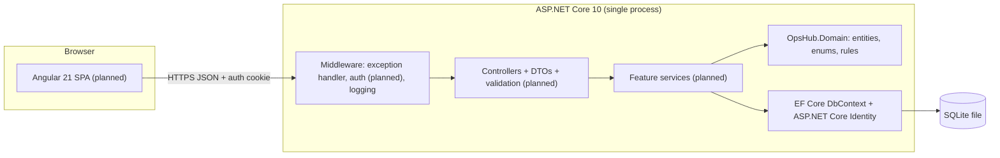
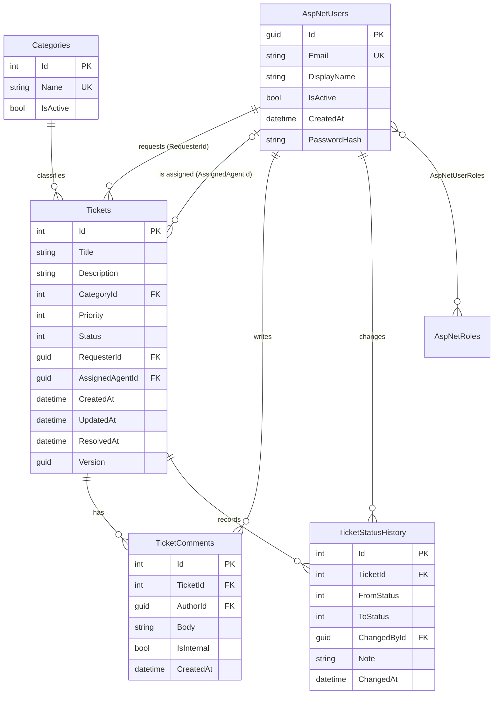

# OpsHub Architecture

This document records the design decisions behind OpsHub and the reasons for them.
It is updated as each phase lands. Sections marked **(planned)** are not built yet.

## 1. Context

OpsHub is an internal service desk for **Marula Logistics**, a fictional company.
Employees (requesters) log support tickets; support agents triage, assign and resolve them;
administrators manage users. All data is fictional.

| Role | Primary tasks |
|---|---|
| Requester | Log a ticket, follow its progress, answer agent questions |
| Support Agent | Work a queue: triage, assign, change status, comment, resolve |
| Administrator | Everything an agent can do, plus manage users and roles |

## 2. System overview



One deployable application (a *monolith*). Microservices, message brokers and containers
would add operational cost without solving any problem this application has.

## 3. Technology choices

| Area | Choice | Reason |
|---|---|---|
| Runtime | .NET 10 (LTS, supported to Nov 2028) | Current long-term-support release; pinned in `global.json`. |
| Data access | EF Core 10 with migrations | Schema changes are versioned C# files that are reviewed and committed. |
| Database | SQLite | A single file with no server to install; runs on Windows, macOS and Linux CI. |
| Users and passwords | ASP.NET Core Identity | Salted PBKDF2 hashing, lockout and roles; we never write our own crypto. |
| API docs | Built-in OpenAPI + Scalar UI | `/openapi/v1.json` and `/scalar` in Development. |
| Errors | RFC 9457 ProblemDetails | Every error has the same JSON shape with a `traceId`. |
| Logging | Built-in `ILogger`, source-generated `[LoggerMessage]`, JSON console outside Development | Structured logging without extra packages. |
| Tests | xUnit 4 on Microsoft.Testing.Platform, `WebApplicationFactory` | Tests boot the real API against an in-memory SQLite database. |
| Time | `TimeProvider` via dependency injection | Tests can control the clock. |

## 4. Solution structure

```
OpsHub/
├─ src/
│  ├─ OpsHub.Domain/        entities, enums, role names (no EF Core / ASP.NET Core)
│  └─ OpsHub.Api/
│     ├─ Data/              DbContext, entity configurations, migrations, seeding
│     ├─ Features/          (planned) controller + DTOs + service per feature
│     └─ Program.cs         composition root: DI registrations and HTTP pipeline
├─ tests/
│  └─ OpsHub.Api.IntegrationTests/
├─ docs/
├─ global.json              pins the .NET SDK and selects the test runner
├─ Directory.Build.props    shared compiler settings (nullable, warnings as errors, analyzers)
└─ dotnet-tools.json        pins the dotnet-ef CLI version
```

**Why not a full Clean Architecture (Application / Infrastructure / Web projects)?**
`DbContext` already implements the unit-of-work and repository patterns. Wrapping it in
repository interfaces would add code without adding a capability we use. The business
rules are still kept apart in `OpsHub.Domain` so they can be unit-tested without a database.

**Deviation from the Phase 1 plan:** `OpsHub.Domain` references
`Microsoft.Extensions.Identity.Stores`, because `AppUser` inherits from `IdentityUser<Guid>`.
That package contains only the Identity base classes; Domain still has no EF Core or ASP.NET Core
dependency.

## 5. Data model



### Constraints and why they exist

| Rule | Where | Why |
|---|---|---|
| Users referenced by tickets cannot be deleted (`ON DELETE RESTRICT`) | Tickets, comments, history FKs | Users are deactivated (`IsActive = false`) so the audit trail keeps its authors. |
| Comments and history are deleted with their ticket (`CASCADE`) | TicketComments, TicketStatusHistory | They have no meaning without the ticket. Tickets themselves are never deleted; *Closed* is the final state. |
| `CK_Tickets_Priority`: 1–4, `CK_Tickets_Status`: 1–5 | Tickets | The database rejects invalid enum values even if the API has a bug. |
| `CK_Tickets_ResolvedAt` | Tickets | Active tickets have no resolution time; *Resolved* tickets must have one; *Closed* may or may not (a ticket can be closed without being resolved). |
| Unique `NormalizedEmail` and `Categories.Name` | Indexes | Email is the sign-in name; category names appear in filters. |
| `Version` concurrency token | Tickets | Rotated on every save. A stale edit throws `DbUpdateConcurrencyException`, to be returned as **409 Conflict**. |
| Enums stored as integers | Priority, Status | Sorting by priority gives Low → Critical; as text, "Critical" would sort first. |
| Timestamps are UTC `DateTime` | All tables | EF Core's SQLite provider cannot order or compare `DateTimeOffset`. A value converter marks values read back as UTC. |

Indexes on `Status`, `Priority`, `CategoryId`, `RequesterId`, `AssignedAgentId` and `UpdatedAt`
match the planned ticket-list filters and default sort.

## 6. Configuration

| Key | Default | Development | Purpose |
|---|---|---|---|
| `ConnectionStrings:OpsHub` | `Data Source=opshub.db` | same | SQLite file (relative to the API project). |
| `Database:ApplyMigrationsOnStartup` | `false` | `true` | Development convenience; production applies migrations deliberately. |
| `Seed:Enabled` | `false` | `true` | Seeds fictional data into an empty database. Refused in Production. |
| `Seed:DemoPassword` | *(unset)* | set via user-secrets | Password for every demo account. Never committed. |

Any key can be overridden by an environment variable, using `__` for `:`
(e.g. `ConnectionStrings__OpsHub`).

## 7. Security model

**Built so far:**
- Passwords are hashed by ASP.NET Core Identity (PBKDF2-HMAC-SHA512, 100,000 iterations, random salt).
- The password policy follows NIST SP 800-63B: minimum 12 characters, no forced character classes.
- No secrets in the repository. The demo password comes from user-secrets or an environment variable.

**(planned, Phase 3+):**
- HttpOnly, `Secure`, `SameSite=Strict` session cookie, with Angular's XSRF token as defence in depth.
- API returns 401/403 instead of redirecting to a login page.
- The current user is always taken from the session, never from request bodies.
- Requester visibility is enforced inside a single query method. Another requester's ticket returns 404, not 403, so its existence is not confirmed.
- Internal comments are filtered on the server.
- Lockout after repeated failed sign-ins.

## 8. Business rules (planned, Phase 4)

| From | Allowed to |
|---|---|
| Open | In Progress, Waiting for Information, Resolved, Closed |
| In Progress | Waiting for Information, Resolved |
| Waiting for Information | In Progress, Resolved |
| Resolved | Closed, In Progress (reopen; the requester may also reopen) |
| Closed | none (final) |

- Entering *Resolved* sets `ResolvedAt`; reopening clears it.
- Every change writes a `TicketStatusHistory` row.
- A requester comment on a *Waiting for Information* ticket moves it back to *In Progress*.
- Tickets can only be assigned to active Support Agents.

## 9. Known risks

| Risk | Mitigation |
|---|---|
| SQLite limits (no `DateTimeOffset` ordering, limited `ALTER TABLE`, weak date arithmetic) | UTC `DateTime`; date maths in C# over projected rows; simple migrations. |
| Data leaking to the wrong requester (IDOR) | One visibility query used everywhere, and integration tests that try to cross the boundary. |
| Cookie auth gotchas (redirects, CSRF) | Explicit 401/403 handling and an antiforgery token. |
| Scope creep | Fixed feature list; extras go to *Future improvements*. |
