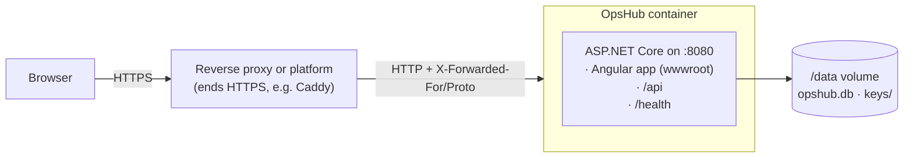

# Deploying OpsHub

How OpsHub runs outside a developer's machine: what the production setup looks like, every
setting, the first deployment, a public demo deployment, upgrades, backups and the checks
to do before going live.

**What has been verified, and how** ([§ 11](#11-how-this-was-verified)): the production build
was run locally in Production and Demo mode over HTTPS, from an empty database, and checked
in the browser and with the smoke test. The container image is built and tested by CI, behind
a real HTTPS reverse proxy. OpsHub has not been deployed to a particular cloud provider; the
instructions below are generic Docker steps.

## 1. How it runs in production



- **One container, one origin.** The API serves the built Angular app as well as `/api`. The
  browser only ever talks to one address, so the `SameSite=Strict` session cookie works and
  no CORS is needed: the same arrangement as the development proxy.
- **HTTPS ends at the proxy.** The container speaks plain HTTP on port 8080. The proxy passes
  on the original scheme and client address in `X-Forwarded-Proto` and `X-Forwarded-For`, and
  OpsHub only believes those headers from proxies listed in `ReverseProxy` settings.
- **The API only works over HTTPS.** Its cookies are `Secure`, so an API request that arrives
  over plain HTTP gets a clear `400 HTTPS is required`. `/health` and the page itself still
  answer over HTTP, because platform health checks use it.
- **`/data` is the only state.** It holds the SQLite database and the keys that sign session
  cookies and XSRF tokens. Lose the database and you lose the data; lose the keys and everyone
  is signed out. Put `/data` on a persistent volume and back it up.
- **Exactly one instance.** SQLite is a file, so OpsHub can't be scaled out to several
  containers as it is ([§ 10](#10-limits)).

## 2. Environments

| | Development | Demo | Production |
|---|---|---|---|
| Used for | Your machine | A public portfolio demo | A real installation |
| Started by | `dotnet run` + `npm start` | Container, `ASPNETCORE_ENVIRONMENT=Demo` | Container (the default) |
| Fictional Marula data | Yes | Yes | **Never** (the app refuses to start) |
| API docs (`/scalar`) | Yes | No | No |
| HSTS | No | Yes | Yes |
| Logs | Readable text | One JSON object per line | One JSON object per line |

(`Testing` is used only by the automated tests.)

## 3. Settings

Every setting can be given as an environment variable: replace `:` with `__` (two
underscores). Lists use an index: `ReverseProxy__KnownNetworks__0`.

| Environment variable | Default (container) | What it does |
|---|---|---|
| `ASPNETCORE_ENVIRONMENT` | `Production` | `Production` or `Demo` ([§ 2](#2-environments)) |
| `ConnectionStrings__OpsHub` | `Data Source=/data/opshub.db` | The SQLite database file |
| `DataProtection__KeysDirectory` | `/data/keys` | Where the cookie-signing keys are kept. Must survive restarts |
| `Database__ApplyMigrationsOnStartup` | `true` | Update the database schema when the app starts ([§ 6](#6-upgrading)) |
| `ReverseProxy__Enabled` | `false` | Believe `X-Forwarded-*` headers from known proxies. Turn on behind a proxy |
| `ReverseProxy__KnownProxies__0`, `__1`, … | none | Exact proxy addresses, e.g. `172.17.0.1` |
| `ReverseProxy__KnownNetworks__0`, `__1`, … | none | Proxy address ranges, e.g. `10.0.0.0/8` |
| `Bootstrap__AdminEmail` | none | First administrator's email ([§ 4](#4-first-deployment)) |
| `Bootstrap__AdminPassword` | none | **Secret.** First administrator's password, at least 12 characters. Remove after the first start |
| `Bootstrap__AdminDisplayName` | `Administrator` | First administrator's name |
| `Seed__Enabled` | `false` | Demo only: fill an empty database with the fictional data |
| `Seed__DemoPassword` | none | **Secret.** Demo only: the password of every fictional account |
| `Auth__LoginAttemptsPerMinute` | `10` | Sign-in requests allowed per client IP address per minute |
| `AllowedHosts` | `*` | Host names the app answers to, e.g. `opshub.example.com` ([§ 9](#9-checklist-before-going-live)) |
| `ASPNETCORE_HTTP_PORTS` | `8080` | Port inside the container |

Secrets belong in an environment file that is never committed (as below) or in the hosting
platform's secret store, never in `appsettings.json` or in the image.

## 4. First deployment

These steps assume a Linux server with Docker, and a reverse proxy on the same server that
handles HTTPS for your domain. They use [Caddy](https://caddyserver.com/), which gets and
renews a certificate by itself; any reverse proxy works.

**1. Build the image** (from the repository root):

```bash
docker build --tag opshub .
```

**2. Write the settings to a file that only you can read.** Keeping the password out of the
command line keeps it out of your shell history and the process list.

```bash
cat > opshub.env <<'EOF'
ReverseProxy__Enabled=true
ReverseProxy__KnownProxies__0=172.17.0.1
Bootstrap__AdminEmail=you@yourcompany.example
Bootstrap__AdminDisplayName=Your Name
Bootstrap__AdminPassword=<a long password of your own>
EOF
chmod 600 opshub.env
```

`172.17.0.1` is the address a container usually sees for a proxy running on the same machine
(the Docker bridge's gateway). Check yours with
`docker network inspect bridge --format '{{(index .IPAM.Config 0).Gateway}}'`.

**3. Start the container.** The port is published on `127.0.0.1` only, so the outside world
can reach OpsHub only through the proxy.

```bash
docker volume create opshub-data
docker run --detach --name opshub --restart unless-stopped \
  --publish 127.0.0.1:8080:8080 \
  --volume opshub-data:/data \
  --env-file opshub.env \
  opshub
docker logs opshub
```

On the first start the log shows the schema being created, the roles and categories being
added, and `Bootstrap created administrator you@yourcompany.example`.

**4. Point the proxy at it.** A complete Caddyfile:

```
opshub.yourcompany.example {
    reverse_proxy 127.0.0.1:8080
}
```

**5. Check the deployment** from any machine with Bash and curl:

```bash
SMOKE_PASSWORD='<the admin password>' scripts/smoke-test.sh https://opshub.yourcompany.example you@yourcompany.example
```

It checks the health endpoint, the page and its security headers, that the API refuses
anonymous calls, a real sign-in, and that ticket categories exist. It only reads.

**6. Remove the bootstrap password.** Delete the `Bootstrap__AdminPassword` line from
`opshub.env` and recreate the container (`docker rm -f opshub`, then step 3 again). The
account stays; the settings are ignored once an administrator exists. Then sign in, change
the password on the **Account** page, and add your agents and requesters under **Users**.

## 5. A public demo

To let visitors try OpsHub with the fictional Marula Logistics data:

```bash
cat > demo.env <<'EOF'
ASPNETCORE_ENVIRONMENT=Demo
Seed__Enabled=true
Seed__DemoPassword=<the password you will publish>
ReverseProxy__Enabled=true
ReverseProxy__KnownProxies__0=172.17.0.1
EOF
docker run --detach --name opshub-demo --publish 127.0.0.1:8080:8080 --env-file demo.env opshub
```

Every fictional account shares the published password, so visitors can change anything,
including other accounts' passwords and the administrator's settings. Treat the demo as
disposable:

- Don't attach a named volume, as above. Docker then gives each new container its own empty
  volume, so recreating the container starts again with fresh demo data.
- Recreate it regularly, for example nightly with a scheduled
  `docker rm --force --volumes opshub-demo` (which also deletes its volume) followed by the
  `docker run` line.
- Consider publishing only a requester and an agent account, not the administrator.

## 6. Upgrading

```bash
git pull
docker build --tag opshub .
docker rm -f opshub
docker run ...   # the same command as in § 4 step 3
```

The data is in the volume, so it survives. Pending database migrations are applied when the
new version starts. **Back up first** ([§ 7](#7-backups)): a migration can't be undone by
starting the old version again.

Migrating at startup is safe because exactly one instance runs. With a server database and
several instances, migrations should become a separate deployment step instead (for example an
EF Core migration bundle), so two instances never migrate at the same time.

## 7. Backups

SQLite keeps recent changes in `opshub.db-wal` next to the database, so copy the whole folder
while the app is stopped. That takes a few seconds of downtime:

```bash
docker stop opshub
docker run --rm --volume opshub-data:/data --volume "$PWD":/backup alpine \
  tar czf /backup/opshub-$(date +%F).tar.gz -C /data .
docker start opshub
```

The archive includes the cookie-signing keys, which are stored **unencrypted**
([§ 9](#9-checklist-before-going-live)). Store backups like secrets, ideally encrypted and
off the server.

**Restore:** stop the container, empty the volume, unpack the archive into it, start again:

```bash
docker stop opshub
docker run --rm --volume opshub-data:/data --volume "$PWD":/backup alpine \
  sh -c 'rm -rf /data/* && tar xzf /backup/opshub-2026-10-25.tar.gz -C /data'
docker start opshub
```

## 8. Health and logs

- **`GET /health`** returns `Healthy` (200) when the app runs and the database answers, and
  503 otherwise. Point the platform's or proxy's health check at it. It works over plain HTTP.
- **Logs** go to standard output (`docker logs opshub`) as one JSON object per line, ready for
  a log platform. Worth alerting on:
  - `Refused an API request made over plain HTTP`: the proxy isn't configured under
    `ReverseProxy`, so sign-in will fail;
  - repeated `Sign-in failed` from many accounts: password guessing;
  - any `Error`.
- **Expected warnings** on a correct installation:
  - `No XML encryptor configured`: see the keys item in [§ 9](#9-checklist-before-going-live);
  - `Failed to determine the https port for redirect`: the container has no HTTPS port of its
    own; the proxy handles HTTPS.

## 9. Checklist before going live

- [ ] HTTPS works at the proxy, and plain HTTP redirects to it (Caddy does both by default).
- [ ] `ReverseProxy__Enabled=true` with the proxy's address. Test: sign-in works, and the log
      has no `Refused an API request made over plain HTTP`.
- [ ] Port 8080 is not reachable from outside the server, only through the proxy.
- [ ] `/data` is a persistent volume, and a backup has been made **and restored once** to
      prove it works.
- [ ] `Bootstrap__AdminPassword` removed after the first start, and that password changed.
- [ ] `ASPNETCORE_ENVIRONMENT` is `Production` (or unset); `Seed__Enabled` is not set.
- [ ] `AllowedHosts` set to your domain, so requests for other host names are refused. Only
      if the platform's health check calls `/health` with an IP address as the host name,
      leave it at `*`.
- [ ] Session keys: on Linux they are stored unencrypted in `/data/keys`. Anyone who can read
      them can forge a session cookie, so the volume and its backups must be protected.
      Encrypting them at rest (with a certificate or a cloud key vault) is a next step.
- [ ] The smoke test passes against the real address.

## 10. Limits

- **Single instance.** SQLite and file-based keys support one running container. Scaling out
  needs a server database (EF Core supports PostgreSQL and SQL Server), shared key storage and
  migrations as a separate step.
- **No outgoing email.** Password resets are done by an administrator; nobody is notified of
  ticket changes.
- **Categories** start as five general IT categories. There is no screen to change them yet.
- **No image registry.** CI builds and tests the image but doesn't publish it; build it on
  the server as above.
- **Keys unencrypted at rest** ([§ 9](#9-checklist-before-going-live)).

## 11. How this was verified

**Automated, on every push** (`.github/workflows/ci.yml`, job *Container*):

1. Build the image from a clean checkout.
2. Start it with an empty volume in Production, behind Caddy as an HTTPS reverse proxy, with
   `ReverseProxy` and `Bootstrap` settings: a first deployment.
3. Run `scripts/smoke-test.sh` through the proxy, verifying TLS against Caddy's own
   certificate authority.
4. Check that plain HTTP straight to the container reaches `/health` but the API refuses it.
5. Restart the container and run the smoke test again: data, keys and the administrator must
   survive, and no second administrator is created.

**Integration tests** (`tests/OpsHub.Api.IntegrationTests`): first-run setup and the
bootstrap rules (`FirstRunTests`), serving the Angular app and its caching and security
headers (`FrontendHostingTests`), trusted and untrusted proxies (`ReverseProxyTests`), the
HTTPS-only API (`HttpsOnlyApiTests`) and key storage (`KeyStorageTests`). The most important
rules were mutation-tested by hand: each was broken on purpose to confirm a test fails.

**By hand** (Windows, without Docker): the published app with the Angular
build in `wwwroot`, run in Production over HTTPS from an empty database. Checks:
- the smoke test;
- in the browser:
  - sign-in through a bookmarked address;
  - filing a ticket;
  - adding a user through the dialog;
  - no Content-Security-Policy violations in the console;
- a restart, after which the session was still valid and the bootstrap step was skipped;
- Demo mode from an empty database.

**Not verified:** a deployment to a real server or cloud platform, and this guide's Docker
commands on a real server. They are standard Docker usage; the CI job covers the same image
and settings.
